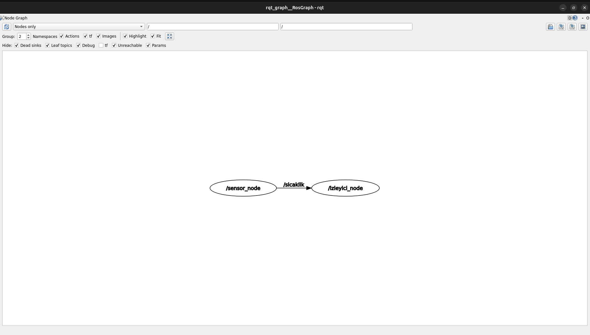

# Sıcaklık İzleyici ROS 2 Paketi

Bu paket, ROS 2 Humble ortamında rastgele sıcaklık verisi yayınlayan bir sensör düğümü ve verileri izleyip eşik aşımında uyarı veren bir izleyici düğümü içerir.

## Kurulum ve Derleme

```bash
cd ~/ros2_ws
colcon build --packages-select sicaklik_izleyici_py
source install/setup.bash
```

## Çalıştırma Adımları

1. **Sensör Düğümünü Başlatma:**
   ```bash
   ros2 run sicaklik_izleyici_py sensor
   ```

2. **İzleyici Düğümünü Başlatma:**
   ```bash
   ros2 run sicaklik_izleyici_py izleyici
   ```

3. **Eşik Değerini Dinamik Değiştirme:**
   ```bash
   ros2 param set /izleyici_node esik_degeri 35.0
   ```

## RQT Graph Görseli


